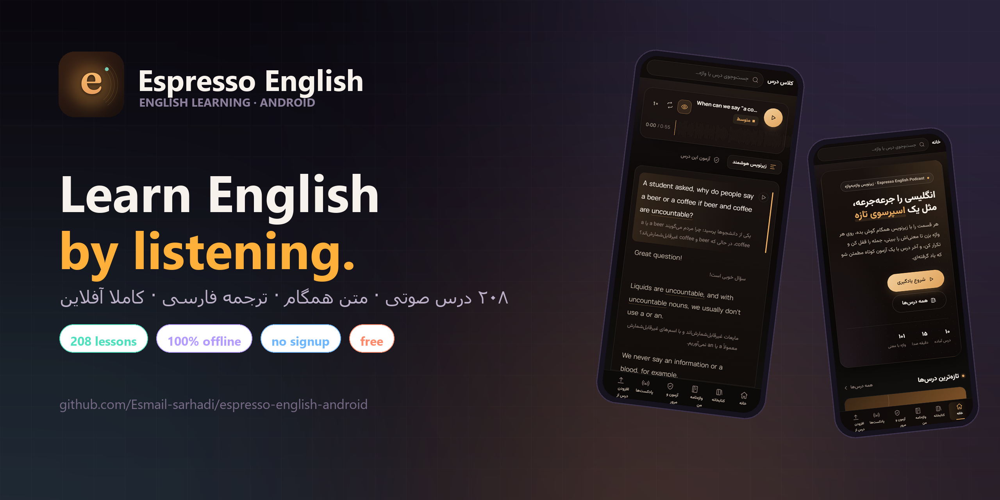
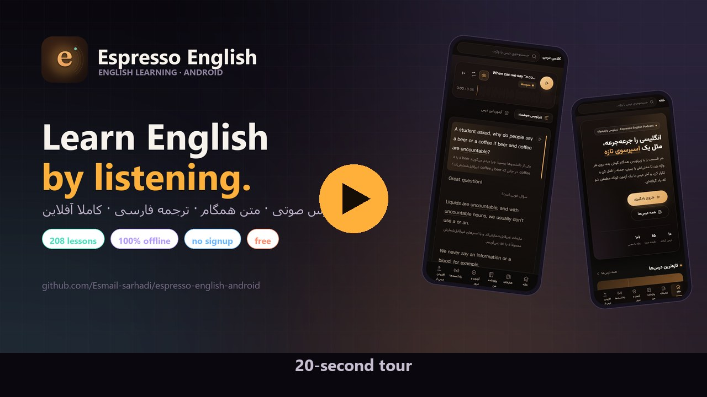
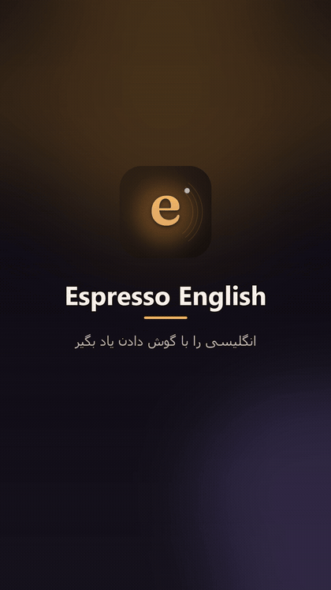
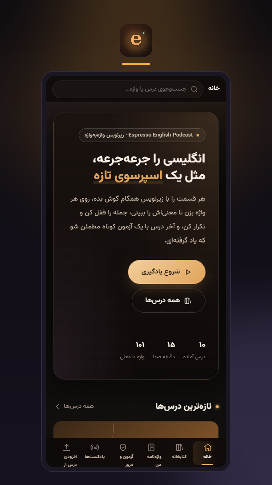
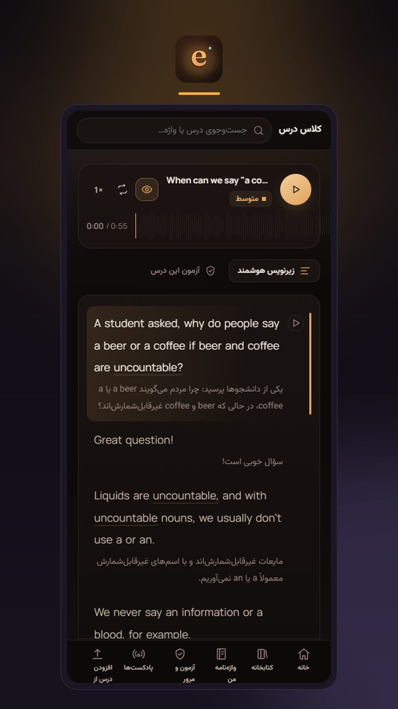
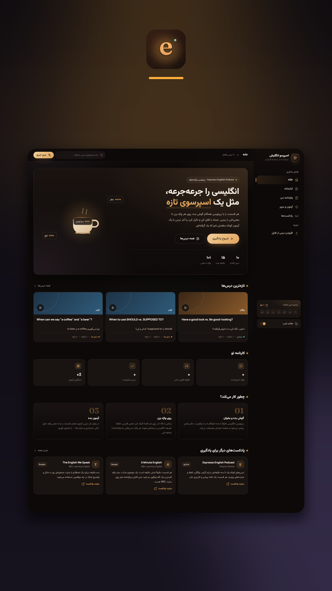
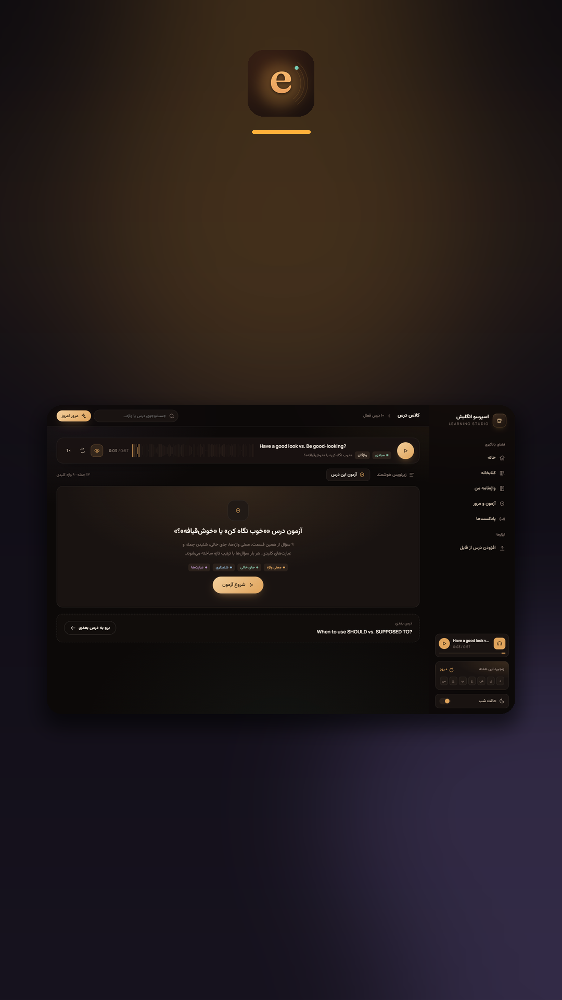
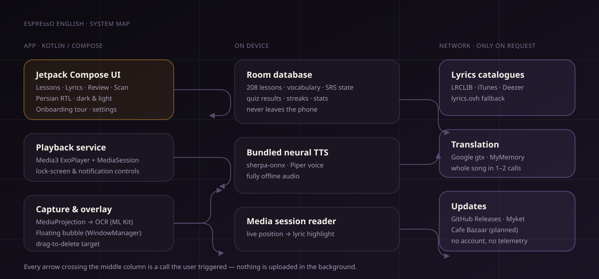

<p align="center">
  <a href="README.md"><b>English</b></a> · <b>فارسی</b>
</p>

<p align="center">
  <a href="https://github.com/Esmail-sarhadi/espresso-english-android/blob/main/assets/readme/banner.png">
    
  </a>
</p>

<p align="center">
  <a href="https://github.com/Esmail-sarhadi/espresso-english-android/releases/latest"></a>
  
  
  
  
  
</p>

<p align="center">
  <a href="https://esmail-sarhadi.github.io/espresso-english-android/"><b>وب‌سایت</b></a> ·
  <a href="#دانلود"><b>دانلود</b></a> ·
  <a href="https://esmail-sarhadi.github.io/espresso-english-android/web/"><b>امتحان در مرورگر</b></a> ·
  <a href="#امکانات"><b>امکانات</b></a> ·
  <a href="#معماری"><b>معماری</b></a> ·
  <a href="docs/MYKET-FA.md"><b>انتشار</b></a> ·
  <a href="README.md"><b>English</b></a>
</p>

<div dir="rtl" align="right">

**یک اپ اندروید آفلاین‌محور که انگلیسی را با گوش دادن یاد می‌دهد.** ۲۰۸ درس با متنی که هم‌زمان با صدا اسکرول می‌شود، ترجمهٔ فارسی روی هر خط، مرور فاصله‌دار و تمرین تلفظ — به‌علاوهٔ دو چیزی که در اپ‌های زبان کم می‌بینی: **ترانه‌ای که همراه آهنگ در حال پخش جلو می‌رود**، و **حبابی شناور** که هر متن انگلیسی روی صفحه را ترجمه می‌کند، بدون اینکه از برنامه‌ای که در آن هستی بیرون بیایی.

> وابسته به پادکست Espresso English نیست. محتوای درس‌ها متعلق به نویسندهٔ آن است — [توضیح کامل](#کپی‌رایت-محتوا).

</div>

---

<div dir="rtl" align="right">

## ▶ تماشا کن

</div>

<p align="center">
  <a href="https://github.com/Esmail-sarhadi/espresso-english-android/raw/main/store/Espresso-English-promo.mp4">
    
  </a>
</p>

<p align="center">
  <a href="https://github.com/Esmail-sarhadi/espresso-english-android/raw/main/store/Espresso-English-promo.mp4"><b>▶ تور ۲۰ ثانیه‌ای (MP4، ۱.۷ مگابایت)</b></a> ·
  <a href="assets/readme/demo.gif"><b>GIF برای اشتراک</b></a> ·
  <a href="https://esmail-sarhadi.github.io/espresso-english-android/web/"><b>نسخهٔ وب</b></a>
</p>

<p align="center">
  
</p>

---

<div dir="rtl" align="right">

## چرا وجود دارد

| مشکلی که داری | کاری که این اپ می‌کند |
|---|---|
| سال‌ها انگلیسی خوانده‌ای و هنوز وقتی کسی حرف می‌زند قفل می‌کنی | ۲۰۸ درس کوتاه که حول **گوش دادن** ساخته شده‌اند، نه جدول گرامر |
| زیرنویس قبل از اینکه بخوانی‌اش می‌رود | متن **خودش** اسکرول می‌شود؛ خطی که شنیده می‌شود روشن است |
| مکث می‌کنی، از اپ بیرون می‌آیی، معنی یک کلمه را می‌بینی، رشته از دست می‌رود | ترجمه **زیر هر خط** است، و حباب شناور **روی برنامه‌های دیگر** کار می‌کند |
| اپ‌هایی که حساب، اشتراک و اینترنت می‌خواهند | بدون ثبت‌نام، بدون تبلیغ، بدون ردیابی — **کل دوره روی گوشی است** |

</div>

---

<div dir="rtl" align="right">

## امکانات

| | قابلیت | کار واقعی |
|---|---|---|
| 🎧 | **۲۰۸ درس** | درس‌های واقعی پادکست، با متن همگام، واژه‌نامه و آزمون |
| 🌍 | **ترجمهٔ خط‌به‌خط** | کل ترانه یا درس در ۱ تا ۲ درخواست، نه ۲۴ |
| 🎵 | **ترانهٔ همگام** | وضعیت پخش هر اپی که آهنگ می‌خواند را می‌خواند و همراه آن جلو می‌رود |
| 🫧 | **حباب ترجمه** | حباب روی هر برنامه → خواندن متن روی گوشی → پنل ترجمه؛ با کشیدن روی ✕ حذفش کن |
| 🔁 | **مرور فاصله‌دار** | زمان‌بندی SM-2؛ واژه‌ها درست قبل از فراموشی برمی‌گردند |
| 🎤 | **تمرین تلفظ** | صدایت را ضبط می‌کنی و نمره می‌گیری |
| 📴 | **واقعاً آفلاین** | صدای عصبی (sherpa-onnx + Piper) داخل برنامه — درس‌ها اینترنت نمی‌خواهند |
| 🎨 | **ساخته‌شده برای فارسی** | رابط راست‌به‌چپ، اعداد فارسی، تم روشن و تاریک، اندازهٔ فونت قابل تغییر |

</div>

---

<div dir="rtl" align="right">

## اسکرین‌شات‌ها

</div>

<p align="center">
  
  
  
  
</p>

---

<div dir="rtl" align="right">

## معماری

</div>

<p align="center">
  
</p>

<div dir="rtl" align="right">

| لایه | انتخاب | چرا |
|---|---|---|
| رابط کاربری | Jetpack Compose · Material 3 | یک سیستم طراحی روی همهٔ اندازه‌ها، راست‌به‌چپ به‌صورت پیش‌فرض |
| ذخیره‌سازی | Room + KSP | درس، واژه، وضعیت مرور و آمار، همه روی دستگاه |
| صدا | Media3 / ExoPlayer + `MediaSessionService` | کنترل از نوار وضعیت و صفحهٔ قفل، بدون کد اضافه |
| گفتار | sherpa-onnx + صدای Piper | صدای عصبی آفلاین، حدود ۳۶ مگابایت، بدون ابر |
| خواندن متن تصویر | ML Kit | روی گوشی؛ تصویر صفحه هرگز فرستاده نمی‌شود |
| ضبط صفحه | سرویس‌های `MediaProjection` | هم اسکن یک‌باره، هم حباب همیشگی |
| وب | React + Vite → **PWA** | همان محتوا در مرورگر، قابل نصب روی آیفون |

</div>

---

<div dir="rtl" align="right">

## دانلود

| منبع | لینک | توضیح |
|---|---|---|
| **گیت‌هاب Releases** | [آخرین نسخه](https://github.com/Esmail-sarhadi/espresso-english-android/releases/latest) | `-ARM.apk` (۱۳۱ مگ) برای گوشی، `-universal.apk` (۲۳۲ مگ) برای امولاتور |
| مایکت | _در حال بررسی_ | رایگان، بدون اشتراک |
| کافه‌بازار | _برنامه‌ریزی‌شده_ | نیاز به اشتراک سالانهٔ توسعه‌دهنده |
| وب / آیفون | [باز کن در مرورگر](https://esmail-sarhadi.github.io/espresso-english-android/web/) | Add to Home Screen — آفلاین کار می‌کند |

**نصب:** فایل ARM را دانلود کن → برای مرورگر «نصب از منابع ناشناس» را روشن کن → باز کن. اندروید ۷.۰ و بالاتر.

</div>

---

<div dir="rtl" align="right">

## ساخت از سورس

</div>

```bash
git clone https://github.com/Esmail-sarhadi/espresso-english-android.git
cd espresso-english-android/android-app

./gradlew :app:assembleDebug             # نسخهٔ دیباگ
./gradlew :app:assembleRelease -ParmOnly # ۱۳۱ مگ، برای گوشی واقعی
./gradlew :app:testDebugUnitTest         # تست‌های منطق ترانه و همگام‌سازی
```

<div dir="rtl" align="right">

امضای نسخهٔ release از `RELEASE_STORE_FILE`، `RELEASE_STORE_PASSWORD`، `RELEASE_KEY_ALIAS` و `RELEASE_KEY_PASSWORD` در `local.properties` یا متغیرهای محیطی خوانده می‌شود. بدون آن‌ها بیلد موفق می‌شود، فقط APK بدون امضا تولید می‌شود.

نسخهٔ وب:

</div>

```bash
cd espresso-english
npm ci && npm run build   # → dist/
npx cap sync ios          # → ios/App (پروژهٔ Xcode)
```

<div dir="rtl" align="right">

پوستهٔ iOS روی رانر رایگان مک‌اواس توسط [`.github/workflows/ios.yml`](.github/workflows/ios.yml) ساخته می‌شود — بدون نیاز به مک.

---

## حریم خصوصی

> بدون حساب، بدون تبلیغ، بدون ابزار تحلیلی. پیشرفت و واژه‌ها در یک پایگاه‌دادهٔ محلی می‌مانند. درخواست شبکه فقط وقتی خودت چیزی را لمس کنی: جستجوی ترانه و ترجمه. مترجم صفحه، متن را **روی گوشی** می‌خواند؛ فقط متن استخراج‌شده برای ترجمه فرستاده می‌شود، نه تصویر.

سیاست کامل: [esmail-sarhadi.github.io/…/privacy.html](https://esmail-sarhadi.github.io/espresso-english-android/privacy.html)

---

## کپی‌رایت محتوا

صدای درس‌ها و متن‌ها از **پادکست Espresso English نوشتهٔ Shayna Oliveira** گرفته شده و مالکیت آن‌ها با نویسنده است. این مخزن *برنامه* را منتشر می‌کند، نه مجوز بازتوزیع آن محتوا. اگر صاحب حق هستی و می‌خواهی درس‌های همراه حذف شوند، یک Issue باز کن؛ بلافاصله رسیدگی می‌شود.

## لایسنس

کد: [MIT](LICENSE). این لایسنس فقط کد را پوشش می‌دهد، نه محتوای شخص ثالث بالا.

</div>

<p align="center">
  <a href="https://github.com/Esmail-sarhadi/espresso-english-android/stargazers"><b>⭐ اگر به کارت آمد، ستاره بده</b></a>
</p>
