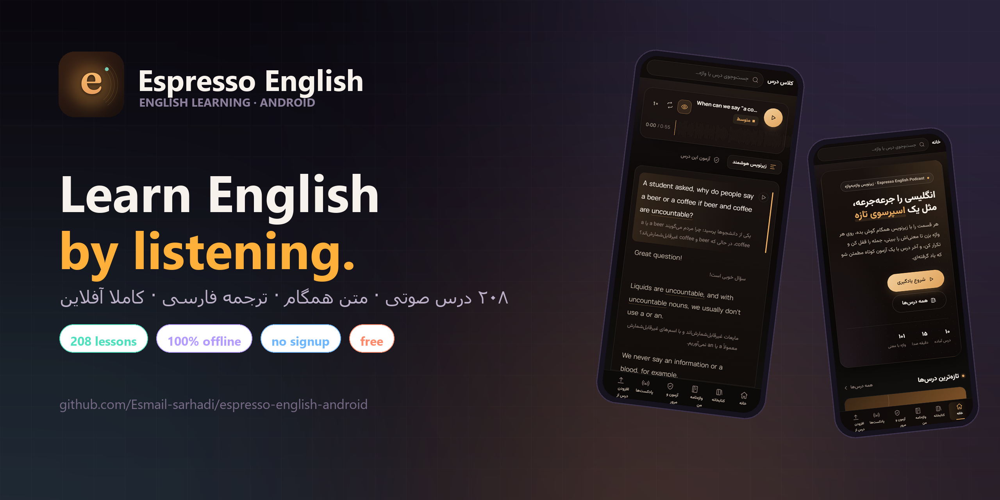
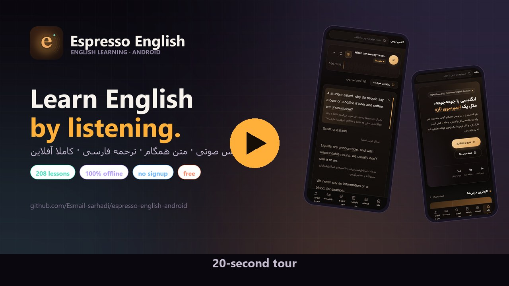
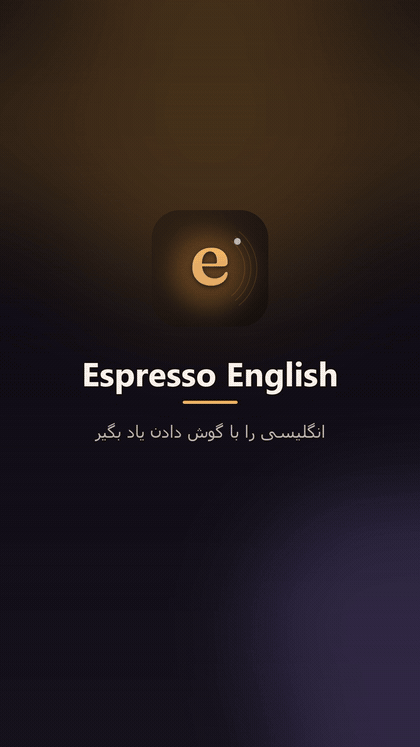
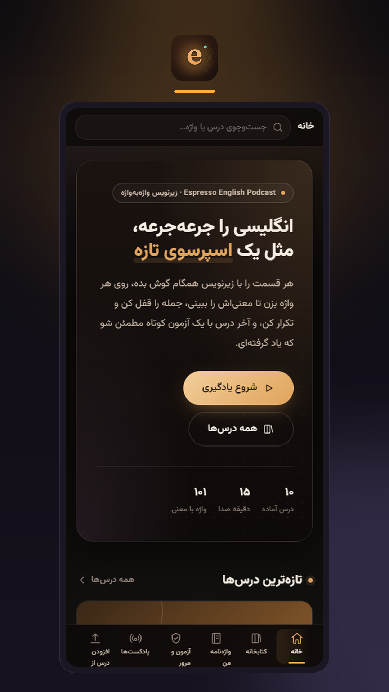
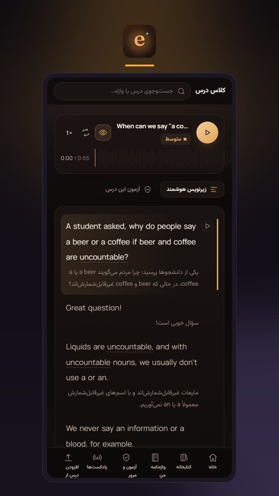
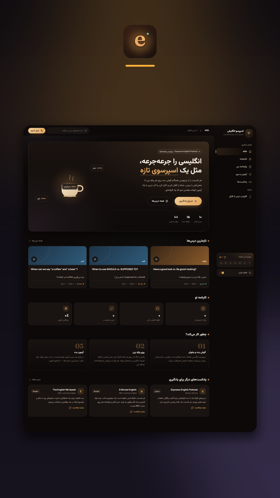
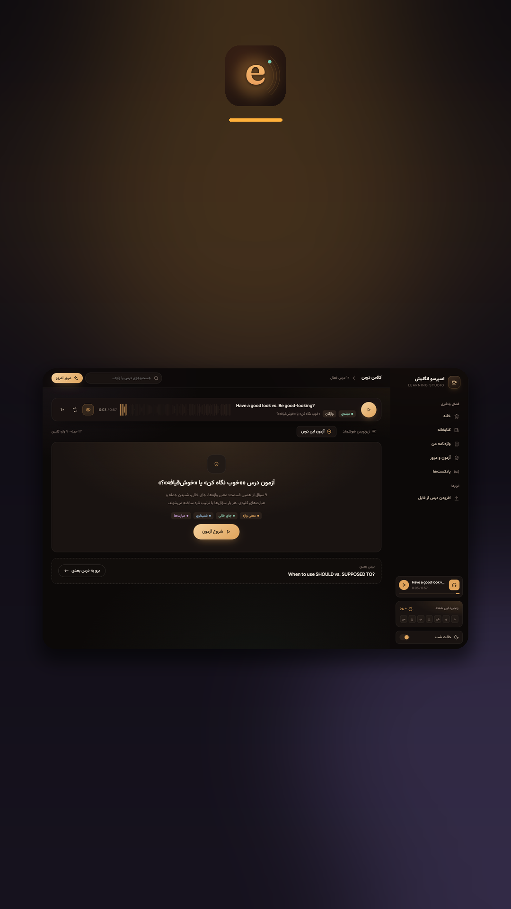
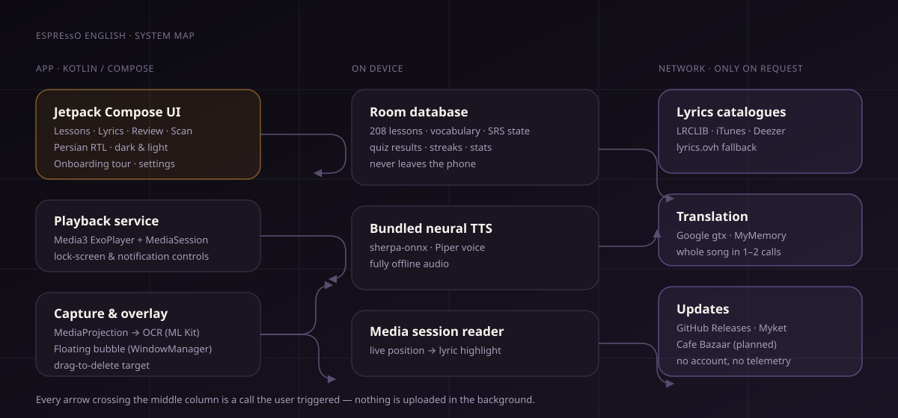

<p align="center">
  <a href="https://github.com/Esmail-sarhadi/espresso-english-android/blob/main/assets/readme/banner.png">
    
  </a>
</p>

<p align="center">
  <a href="https://github.com/Esmail-sarhadi/espresso-english-android/releases/latest"></a>
  
  
  
  
  
</p>

<p align="center">
  <a href="https://esmail-sarhadi.github.io/espresso-english-android/"><b>Website</b></a> ·
  <a href="#download"><b>Download</b></a> ·
  <a href="https://esmail-sarhadi.github.io/espresso-english-android/web/"><b>Try in browser</b></a> ·
  <a href="#features"><b>Features</b></a> ·
  <a href="#architecture"><b>Architecture</b></a> ·
  <a href="docs/MYKET-FA.md"><b>Publishing</b></a> ·
  <a href="#فارسی"><b>فارسی</b></a>
</p>

**An offline-first Android app that teaches English by listening.** 208 lessons with a transcript that scrolls in time with the audio, a Persian translation on every line, spaced-repetition review, pronunciation scoring — plus two things you rarely see in a language app: **lyrics that follow whatever song is playing** on the phone, and a **floating bubble** that translates any English on screen without leaving the app you were reading.

> Not affiliated with the Espresso English podcast. The lesson content belongs to its author — see [Content attribution](#content-attribution).

<div dir="rtl" align="right">

> **خلاصهٔ فارسی** — یک اپ اندروید برای یادگیری انگلیسی با گوش دادن: ۲۰۸ درس با متن همگام و ترجمهٔ فارسی، مرور فاصله‌دار، تمرین تلفظ، ترانهٔ همگام با موسیقی و حباب شناور ترجمه. کاملاً آفلاین، رایگان، بدون ثبت‌نام و بدون تبلیغ.

</div>

---

## ▶ Watch it

<p align="center">
  <a href="https://github.com/Esmail-sarhadi/espresso-english-android/raw/main/store/Espresso-English-promo.mp4">
    
  </a>
</p>

<p align="center">
  <a href="https://github.com/Esmail-sarhadi/espresso-english-android/raw/main/store/Espresso-English-promo.mp4"><b>▶ 20-second tour (MP4, 1.7 MB)</b></a> ·
  <a href="assets/readme/demo.gif"><b>GIF for sharing</b></a> ·
  <a href="https://esmail-sarhadi.github.io/espresso-english-android/web/"><b>Live web demo</b></a>
</p>

<p align="center">
  
</p>

---

## Why it exists

| The problem | What this app does instead |
|---|---|
| You have studied English for years and still freeze when someone speaks | 208 short lessons built around **listening**, not grammar tables |
| Subtitles disappear before you finish reading them | The transcript **scrolls itself**; the line being spoken is lit up |
| You pause, leave the app, look up a word, lose the thread | Translation sits **under every line**, and the floating bubble works **over other apps** |
| Apps that need an account, a subscription and an internet connection | No signup, no ads, no telemetry — **the whole course is on the phone** |

---

## Features

| | Feature | What it actually does |
|---|---|---|
| 🎧 | **208 lessons** | Real podcast lessons with synced transcript, vocabulary and a quiz |
| 🌍 | **Line-by-line Persian** | Whole song or lesson translated in 1–2 requests, not 24 |
| 🎵 | **Live lyric sync** | Reads the media session of whatever is playing and follows it, karaoke style |
| 🫧 | **Floating translator** | Bubble over any app → on-device OCR → translation panel; drag it onto ✕ to dismiss |
| 🔁 | **Spaced repetition** | SM-2 scheduling; words return right before you would forget them |
| 🎤 | **Pronunciation** | Record yourself, get a score |
| 📴 | **Truly offline** | Neural voice (sherpa-onnx + Piper) bundled — no network needed for lessons |
| 🎨 | **Made for Persian** | RTL layout, Persian numerals, dark & light themes, adjustable type scale |

---

## Screenshots

<p align="center">
  
  
  
  
</p>

---

## Architecture

<p align="center">
  
</p>

| Layer | Choice | Why |
|---|---|---|
| UI | Jetpack Compose · Material 3 | One design system across phone sizes, RTL by default |
| Storage | Room + KSP | Lessons, vocabulary, SRS state and stats live on device |
| Audio | Media3 / ExoPlayer + `MediaSessionService` | Lock-screen and notification controls for free |
| Speech | sherpa-onnx + Piper voice | Offline neural TTS, ~36 MB, no cloud |
| OCR | ML Kit text recognition | On-device; the screenshot never leaves the phone |
| Capture | `MediaProjection` foreground services | One-shot scan **and** the persistent bubble |
| Web | React + Vite → **PWA** | Same content in a browser, installable on iOS |

---

## Download

| Source | Link | Notes |
|---|---|---|
| **GitHub Releases** | [Latest release](https://github.com/Esmail-sarhadi/espresso-english-android/releases/latest) | `-ARM.apk` (131 MB) for phones, `-universal.apk` (232 MB) for emulators |
| Myket | _pending review_ | Free, no subscription |
| Cafe Bazaar | _planned_ | Annual developer subscription required |
| Web / iOS | [Open in browser](https://esmail-sarhadi.github.io/espresso-english-android/web/) | Add to Home Screen — works offline |

**Install:** download the ARM APK → allow "install unknown apps" for your browser → open it. Android 7.0+.

---

## Build from source

```bash
git clone https://github.com/Esmail-sarhadi/espresso-english-android.git
cd espresso-english-android/android-app

./gradlew :app:assembleDebug             # debug build
./gradlew :app:assembleRelease -ParmOnly # 131 MB, real phones
./gradlew :app:testDebugUnitTest         # lyric/sync maths, pure JVM
```

Release signing reads `RELEASE_STORE_FILE`, `RELEASE_STORE_PASSWORD`, `RELEASE_KEY_ALIAS` and
`RELEASE_KEY_PASSWORD` from `local.properties` or the environment. Without them the build still
succeeds — it just produces an unsigned APK.

Web app:

```bash
cd espresso-english
npm ci && npm run build   # → dist/
npx cap sync ios          # → ios/App (Xcode project)
```

The iOS shell is built on a free macOS runner by [`.github/workflows/ios.yml`](.github/workflows/ios.yml) — no Mac required.

---

## Privacy

> No account, no ads, no analytics SDK. Progress and vocabulary live in a local database. Network calls happen only when you tap something: lyrics lookup and translation. The screen translator runs OCR **on device**; only the extracted text is sent for translation, never the image.

Full policy: [esmail-sarhadi.github.io/…/privacy.html](https://esmail-sarhadi.github.io/espresso-english-android/privacy.html)

---

## Content attribution

The lesson audio and transcripts are derived from the **Espresso English podcast by Shayna Oliveira** and remain the property of their author. This repository publishes the *application*, not a licence to redistribute that content. If you are the rights holder and want the bundled lessons removed, open an issue and it will be handled immediately.

## License

Code: [MIT](LICENSE). That covers the code only — not the third-party lesson content above.

<p align="center">
  <a href="https://github.com/Esmail-sarhadi/espresso-english-android/stargazers"><b>⭐ If this is useful, star the repo</b></a>
</p>

---

<div dir="rtl" align="right">

## فارسی

**Espresso English** یک اپ اندروید برای یادگیری انگلیسی با گوش دادن است.

- **۲۰۸ درس** با متن انگلیسی هم‌زمان با صدا و ترجمهٔ فارسی خط‌به‌خط
- **مرور فاصله‌دار**، آزمون، واژه‌نامه و تمرین تلفظ
- **ترانهٔ همگام** — آهنگ در حال پخش را تشخیص می‌دهد و متنش را همراه موسیقی جلو می‌برد
- **حباب شناور ترجمه** — روی هر برنامه‌ای؛ برای حذف، حباب را بکش و روی ✕ رها کن
- **کاملاً آفلاین** — صدا داخل برنامه است، بدون نیاز به اینترنت
- **بدون ثبت‌نام، بدون تبلیغ، بدون ردیابی**

**نصب:** از بخش [Releases](https://github.com/Esmail-sarhadi/espresso-english-android/releases/latest) فایل `-ARM.apk` را دانلود کن (۱۳۱ مگابایت). اندروید ۷ و بالاتر.

**نسخهٔ وب (آیفون):** [همین‌جا باز کن](https://esmail-sarhadi.github.io/espresso-english-android/web/) و از Safari گزینهٔ «Add to Home Screen» را بزن.

راهنمای انتشار در استورها: [`docs/MYKET-FA.md`](docs/MYKET-FA.md) · [`docs/PUBLISHING-FA.md`](docs/PUBLISHING-FA.md)

</div>
